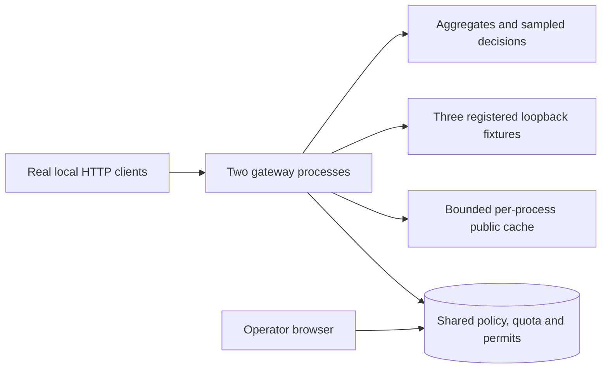

# GateTrellis

Keep useful API work moving when requests arrive faster than a backend can serve them. Explain each quota, overload, cache and timeout decision without hiding rejected traffic inside success metrics.

**Stage:** requirements and design baseline, 23 November 2026. Runtime implementation has not started. Acceptance, load and recovery results are NOT RUN.

Every request pins one complete policy version. Shared quotas, finite permits and bounded queues apply across gateway processes; mutation timeouts never trigger automatic unsafe retries.

Start with the [documentation guide](docs/README.md), [product scope](docs/requirements/product.md), [high-level architecture](docs/architecture/high-level-design.md) and [component designs](docs/design/README.md).

[Worked examples](examples/README.md), [JSON Schemas](schemas/README.md) and [reference SQL](schemas/reference-schema.sql) accompany the design. They specify contracts; they do not constitute an engine implementation.

The reference design uses Python services, SQLite coordination on local disk, and basic locally served HTML/CSS/JavaScript. Exact dependencies remain subject to permitted-environment verification. [Capacity analysis](docs/testing/performance-and-capacity.md) separates real local evidence from unverified deployment arithmetic.

Public repository, [MIT license](LICENSE). The [original requirements](docs/source/High_Traffic_API_Gateway_Requirements.md) remain archived. Documentation is AI-assisted; programme decisions and participant-authored answers remain separate.
