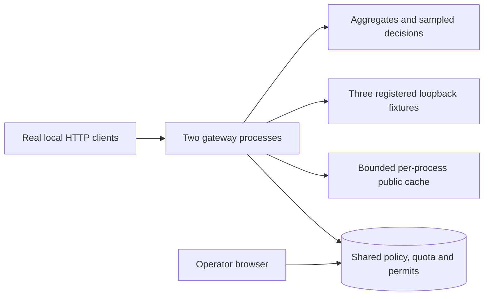
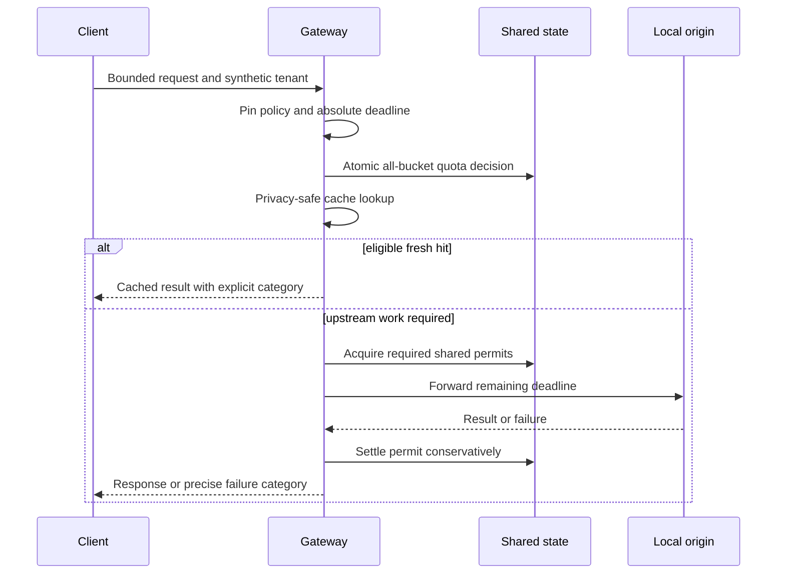

# High-level design

Keep useful API work moving when requests arrive faster than a backend can serve them. Explain each quota, overload, cache and timeout decision without hiding rejected traffic inside success metrics.

## Deployment boundary

Every request pins one complete policy version. Shared quotas, finite permits and bounded queues apply across gateway processes; mutation timeouts never trigger automatic unsafe retries.

All runtime services are ordinary local processes. Assets stay local, HTTP targets stay on loopback, and the canonical store lives outside synchronized/network folders. Supporting multiple application processes demonstrates shared-state races; it does not establish cross-machine fault tolerance.

## Main journey

## Logical components

| Component | Responsibility |
| --- | --- |
| [Policy validation activation and route matching](../design/policies.md) | Validate the complete candidate including deterministic method/prefix priority and target registry references. |
| [Atomic hierarchical token buckets](../design/quotas.md) | Resolve tenant/route bucket identities under the pinned policy. |
| [Shared permits queues and tenant isolation](../design/bulkheads.md) | Reserve bounded local queue count and byte budget before waiting. |
| [Balancing health and coordinated circuit probes](../design/origins.md) | Filter the registered loopback pool by policy capability, readiness and drain state. |
| [Deadlines safe retries and disconnect cleanup](../design/deadlines.md) | Create one absolute deadline at receipt; validation, queueing, connect, attempts and backoff all consume it. |
| [Public cache keys refresh collapse and fencing](../design/cache.md) | Bypass authorization/cookie/personalized requests and private/no-store/set-cookie responses. |
| [Decision accounting goodput and bounded traces](../design/measurement.md) | Record every offered arrival as not-sent or actually sent using the generator schedule. |

Control API, browser, storage, observability and test harness have separate designs. The [transaction protocol](../design/transactions.md) governs every durable mutation.

## Capacity boundary

Local qualification: Two gateway processes, three local upstream fixtures; calibrate at 100 real requests/s and target 1,000 offered small requests/s for 60 seconds. Cache-hit and uncached profiles are separate.

Analytical study: Ten million incoming requests/minute = 166,666.67 requests/s. At 2 KiB response payload this is 341.33 MB/s or 2.7307 Gbit/s before overhead. A modeled 90% eligible cache-hit rate leaves 16,666.67 origin primaries/s before retries and refreshes.

The canonical shared writer and hot-key state remain known serialization points. Production partitioning/edge deployments are analysis only until implemented and failure-tested.
