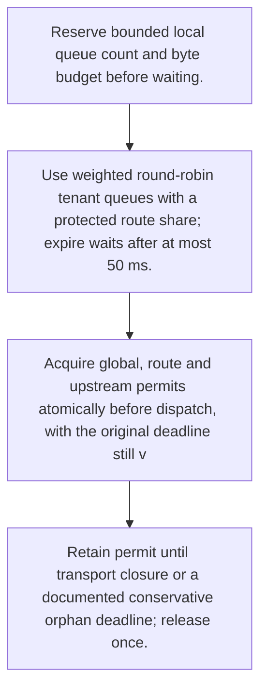

# Shared permits queues and tenant isolation

The design uses shared canonical permit rows, not one independent limit per process. Lowered caps drain existing work. Cooperative fixtures have enforceable request deadlines; noncooperative origins can outlive a gateway connection, so authorized concurrency is not proof of physical downstream work stopping.

## Algorithm

1. Reserve bounded local queue count and byte budget before waiting.
2. Use weighted round-robin tenant queues with a protected route share; expire waits after at most 50 ms.
3. Acquire global, route and upstream permits atomically before dispatch, with the original deadline still valid.
4. Retain permit until transport closure or a documented conservative orphan deadline; release once.

## Interfaces and storage boundary

Inputs include the target identity, caller/process identity, expected version/generation when applicable and operation key. The service returns a bounded committed result or stable error. [API fields](../contracts/api.md) and [data entities](../contracts/data-model.md) define the interface. No network send or computation waits inside the database writer.

The [transaction protocol](transactions.md) handles repeated receipts, contention, uncertain COMMIT and current-authority checks. New work rechecks mutable state after acquiring the writer. A stale client is not silently upgraded to a newer revision.

## Required behavior

## Capacity bulkheads and queueing

Global, route and upstream concurrency are finite. Acquire required permits atomically or with a tested no-leak protocol before forwarding. Limits protect gateway-authorized attempts; they do not magically stop arbitrary downstream work that survives a lost connection.

Pending queues are bounded by count and bytes, with a maximum waiting duration, initially 50 ms. A request waits only if useful service can plausibly finish within its remaining deadline. Otherwise reject early with 503 overload and documented retry guidance. Health/administration has separate small capacity so diagnostics survive overload.

An active attempt holds its permit until upstream transport has closed or a documented conservative lease/deadline rule makes orphan authority safe. Cancellation requests alone are not proof the upstream stopped. Cooperative local fixtures observe cancellation and deadlines; noncooperative-origin limits must be reported separately. Crash recovery never releases the same permit twice or silently multiplies capacity across gateway replicas.

Isolate synthetic tenants with explicit bounded shares or fair queue scheduling. State the fairness rule and measure starvation; strict global request FIFO is not required. Protect a small low-volume route from a burst on another route using separate bulkheads.

## Recovery and evidence

A failure before commit exposes no accepted transition; a lost response after commit is resolved with the same key. A second reconciler reloads current state and cannot duplicate a terminal transition. Test both serialization orders at the relevant race, using the [harness](../testing/harness-and-fixtures.md) and [source acceptance cases](../testing/acceptance-plan.md). These are planned tests, not observed results.
