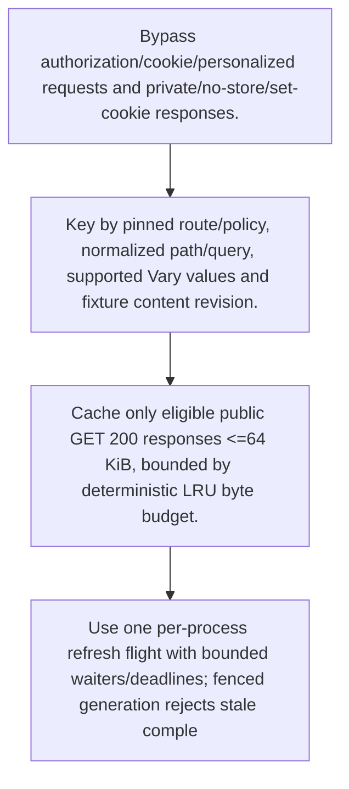

# Public cache keys refresh collapse and fencing

The baseline cache is per process, so a cold key may trigger at most one refresh per gateway process, not one global refresh. Refill goes through ordinary permits and retry budget. Stale responses require an explicit finite route window and visible category. RFC 9111 informs boundaries; this is a constrained subset.

## Algorithm

1. Bypass authorization/cookie/personalized requests and private/no-store/set-cookie responses.
2. Key by pinned route/policy, normalized path/query, supported Vary values and fixture content revision.
3. Cache only eligible public GET 200 responses <=64 KiB, bounded by deterministic LRU byte budget.
4. Use one per-process refresh flight with bounded waiters/deadlines; fenced generation rejects stale completion.

## Interfaces and storage boundary

Inputs include the target identity, caller/process identity, expected version/generation when applicable and operation key. The service returns a bounded committed result or stable error. [API fields](../contracts/api.md) and [data entities](../contracts/data-model.md) define the interface. No network send or computation waits inside the database writer.

The [transaction protocol](transactions.md) handles repeated receipts, contention, uncertain COMMIT and current-authority checks. New work rechecks mutable state after acquiring the writer. A stale client is not silently upgraded to a newer revision.

## Required behavior

## Public caching and stampede control

Cache only explicitly eligible public GET responses from local fixture routes. Bypass requests with authorization/cookies or personalized context, and bypass responses marked private/no-store or containing session-setting headers. Include route/policy generation, normalized path/query and supported Vary dimensions in the cache key. Unknown Vary values bypass caching.

Respect configured origin freshness and validators for the supported subset; document that this is a constrained gateway cache, not full HTTP cache compliance. Initially cache only 200 responses below 64 KiB, with bounded total bytes and deterministic eviction. Do not cache errors, mutations or response bodies exceeding the cap.

Collapse concurrent misses for the same key into one refresh per gateway cache owner; bound waiters and their deadlines. If caches are per process, document up to one refresh per process rather than falsely claiming one cluster-wide fetch. The reference shared-key lease protocol may reduce this to one global refresh if implemented and tested. Expired refresh authority cannot overwrite a newer cache generation.

Serving stale public data is allowed only by an explicit route rule with a finite stale window and a visible response/metric indicator. It must not bypass privacy checks or claim fresh success. Cache invalidation includes policy version and fixture content revision so a control change cannot expose old incompatible data.

## Recovery and evidence

A failure before commit exposes no accepted transition; a lost response after commit is resolved with the same key. A second reconciler reloads current state and cannot duplicate a terminal transition. Test both serialization orders at the relevant race, using the [harness](../testing/harness-and-fixtures.md) and [source acceptance cases](../testing/acceptance-plan.md). These are planned tests, not observed results.
