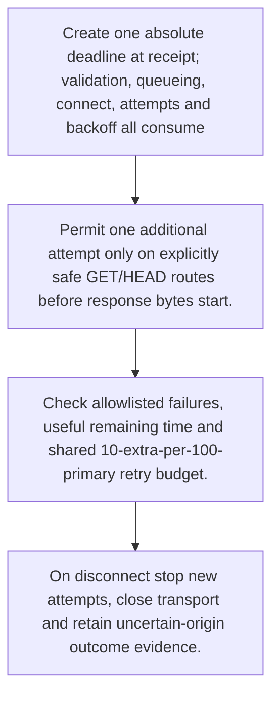

# Deadlines safe retries and disconnect cleanup

A forwarded mutation is never automatically retried because an idempotency header was supplied. The retry window is proposed as rolling 60 seconds; the first 100-primary boundary allows at most floor(primary/10) extras, preventing a free startup burst. Attempt limits never reset the client deadline.

## Algorithm

1. Create one absolute deadline at receipt; validation, queueing, connect, attempts and backoff all consume it.
2. Permit one additional attempt only on explicitly safe GET/HEAD routes before response bytes start.
3. Check allowlisted failures, useful remaining time and shared 10-extra-per-100-primary retry budget.
4. On disconnect stop new attempts, close transport and retain uncertain-origin outcome evidence.

## Interfaces and storage boundary

Inputs include the target identity, caller/process identity, expected version/generation when applicable and operation key. The service returns a bounded committed result or stable error. [API fields](../contracts/api.md) and [data entities](../contracts/data-model.md) define the interface. No network send or computation waits inside the database writer.

The [transaction protocol](transactions.md) handles repeated receipts, contention, uncertain COMMIT and current-authority checks. New work rechecks mutable state after acquiring the writer. A stale client is not silently upgraded to a newer revision.

## Required behavior

## Request lifecycle and outcome classification

Lifecycle is RECEIVED, VALIDATED, QUOTA_CHECKED, CACHE_CHECKED, WAITING_CAPACITY where permitted, FORWARDED, then COMPLETED, REJECTED, TIMED_OUT or CANCELLED. Retries are child attempts of one client request and preserve its original absolute deadline.

Every request has a gateway correlation ID, synthetic tenant, route/policy version and final category. Categories distinguish malformed input, quota rejection, overload rejection, circuit open, upstream timeout, upstream error, cache result, successful forwarding and client disconnect. A rejected request is not successful application goodput.

Validation bounds bytes before expensive parsing. No request is queued indefinitely or dispatched after its deadline. Admission and cache policies are explicit: synthetic tenant quotas count all requests, including cache hits; upstream concurrency applies only to forwarded attempts.

## Deadlines cancellation and retries

Every request has a finite gateway absolute deadline; default local profile is 1 second. Connect, queue, each attempt and retry delay all consume this budget. Do not reset the deadline on failover. Propagate remaining budget to cooperative fixtures and stop forwarding when no useful time remains.

Only explicitly safe GET/HEAD routes may automatically retry in the first release, at most one additional attempt and only before response bytes have been committed to the client. Mutation requests are not retried merely because an idempotency header exists. Extending retry support requires a verified origin idempotency contract and new tests.

Retryable connection failures/status codes are allowlisted. Apply bounded jitter and a shared retry budget, initially no more than 10 extra attempts per 100 primary upstream attempts over a documented window. Circuit-open, quota rejection and exhausted deadlines do not trigger immediate loops. A retry consumes concurrency and is counted in amplification metrics.

A client disconnect triggers cancellation/cleanup; the request outcome records uncertainty if the origin might have committed a side effect. Never fabricate a success or assert a downstream rollback from a connection close.

## Recovery and evidence

A failure before commit exposes no accepted transition; a lost response after commit is resolved with the same key. A second reconciler reloads current state and cannot duplicate a terminal transition. Test both serialization orders at the relevant race, using the [harness](../testing/harness-and-fixtures.md) and [source acceptance cases](../testing/acceptance-plan.md). These are planned tests, not observed results.
