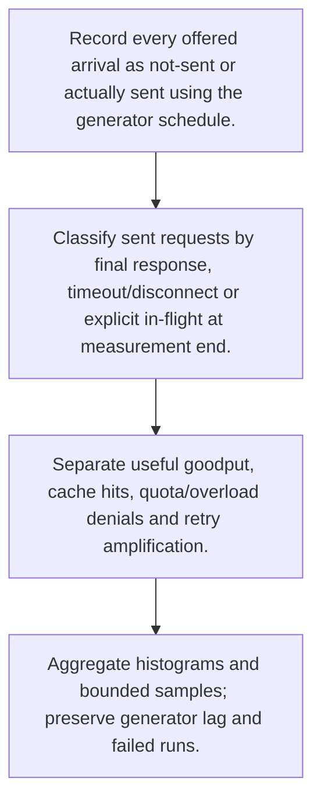

# Decision accounting goodput and bounded traces

A low latency percentile among a tiny successful subset is not the system latency result. End-of-window reconciliation includes unresolved requests rather than dropping them. The browser is a small diagnostic client; actual load comes from a capped open-loop HTTP generator.

## Algorithm

1. Record every offered arrival as not-sent or actually sent using the generator schedule.
2. Classify sent requests by final response, timeout/disconnect or explicit in-flight at measurement end.
3. Separate useful goodput, cache hits, quota/overload denials and retry amplification.
4. Aggregate histograms and bounded samples; preserve generator lag and failed runs.

## Interfaces and storage boundary

Inputs include the target identity, caller/process identity, expected version/generation when applicable and operation key. The service returns a bounded committed result or stable error. [API fields](../contracts/api.md) and [data entities](../contracts/data-model.md) define the interface. No network send or computation waits inside the database writer.

The [transaction protocol](transactions.md) handles repeated receipts, contention, uncertain COMMIT and current-authority checks. New work rechecks mutable state after acquiring the writer. A stale client is not silently upgraded to a newer revision.

## Required behavior

## Request lifecycle and outcome classification

Lifecycle is RECEIVED, VALIDATED, QUOTA_CHECKED, CACHE_CHECKED, WAITING_CAPACITY where permitted, FORWARDED, then COMPLETED, REJECTED, TIMED_OUT or CANCELLED. Retries are child attempts of one client request and preserve its original absolute deadline.

Every request has a gateway correlation ID, synthetic tenant, route/policy version and final category. Categories distinguish malformed input, quota rejection, overload rejection, circuit open, upstream timeout, upstream error, cache result, successful forwarding and client disconnect. A rejected request is not successful application goodput.

Validation bounds bytes before expensive parsing. No request is queued indefinitely or dispatched after its deadline. Admission and cache policies are explicit: synthetic tenant quotas count all requests, including cache hits; upstream concurrency applies only to forwarded attempts.

## Measured desktop acceptance targets

Begin with a 100-real-request/second calibration. Provisional target is 1,000 offered small HTTP requests/second through 2 gateway processes against trivial local fixture reads, for 60 seconds, within available resources. Cache-hit and uncached profiles are measured separately; target is not automatically required of a deliberately slow backend.

Record p50/p95/p99 total latency, goodput, error categories, queue occupancy, permit occupancy, retry amplification, cache rate, bytes, generator start delay and CPU/RAM for every component. Provisional gateway-added p95 overhead on an unloaded fast fixture is <=20 ms; local UI update <=3 seconds; total service/store steady-state memory <=2 GiB excluding browser/generator/build. Calibrate upstream capacity before overload tests.

At two to five times calibrated useful backend capacity, queues remain bounded, the low-volume protected route retains its configured share, and admitted useful work does not collapse into timeouts solely because the gateway accepted unbounded demand. Report the measured comparison, not a promised universal latency bound.

## Load methodology and scale arithmetic

Use open-loop arrivals for overload and record scheduled versus actual start time to expose generator lag. A closed-loop client test may be supplementary but must not hide reduced offered traffic when latency rises. Reconcile offered count with generator-not-sent, actual sent and every final response/timeout/disconnect. Measure socket/pool reuse explicitly.

A long run may issue 1 million sequential/multiplexed local requests, but that count is not 1 million simultaneous users. Keep a resource/time cap and report incomplete runs honestly. Tests target only the local fixtures, use no system-wide network changes and stop before exhausting the desktop.

The architectural target 10,000,000 requests/minute equals about 166,667 requests/second. At 2 KiB response payload each, application response traffic alone is about 341.3 MB/second or 2.73 Gbit/second, excluding request traffic, HTTP/TLS overhead and retransmission. At a modeled 90 percent eligible cache-hit rate, average origin demand would be about 16,667 requests/second before refreshes/retries; cache eligibility, skew and misses make this an assumption, not evidence.

Capacity study must model hot keys, shared quota serialization, cache ownership, connection pools, failure reserve and egress separately. Derive node counts from measured sustainable CPU/network/connection limits with explicit utilization headroom. Identify operations that still serialize globally. Explain which higher-scale redesigns are unimplemented. Neither a central database transaction per request nor added gateway replicas is automatically a production-scale solution.

## Recovery and evidence

A failure before commit exposes no accepted transition; a lost response after commit is resolved with the same key. A second reconciler reloads current state and cannot duplicate a terminal transition. Test both serialization orders at the relevant race, using the [harness](../testing/harness-and-fixtures.md) and [source acceptance cases](../testing/acceptance-plan.md). These are planned tests, not observed results.
