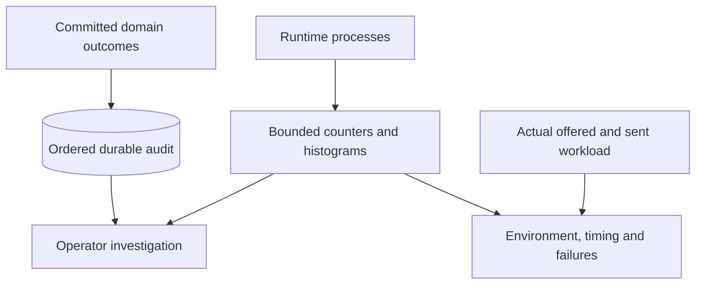

# Observability and measurement semantics

Liveness reports process response; readiness requires store/schema/config integrity. Logs use correlation and applicable release/journey/hold, route/request/attempt or room/session/worker IDs. Tokens and reusable secrets are redacted. Control/business audit is transactional; high-volume telemetry is sampled/aggregated.

Show offered/sent/admitted/completed useful traffic, all rejection/timeouts, attempt amplification, quota balances, queue/permit occupancy and cache freshness. One million 429s is not one million useful successes.

Keep bounded labels in metrics and individual IDs in drill-down samples. [Performance and capacity](../testing/performance-and-capacity.md) preserves all source targets and assumptions. Runtime results remain NOT RUN.
