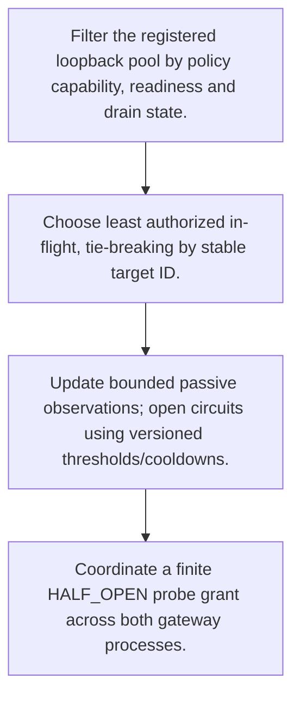

# Balancing health and coordinated circuit probes

Proposed initial circuit thresholds are five consecutive retryable origin failures, five-second cooldown and one shared half-open probe. They are configurable design defaults pending calibration. Health checks have separate small capacity and cannot create uncontrolled failover load.

## Algorithm

1. Filter the registered loopback pool by policy capability, readiness and drain state.
2. Choose least authorized in-flight, tie-breaking by stable target ID.
3. Update bounded passive observations; open circuits using versioned thresholds/cooldowns.
4. Coordinate a finite HALF_OPEN probe grant across both gateway processes.

## Interfaces and storage boundary

Inputs include the target identity, caller/process identity, expected version/generation when applicable and operation key. The service returns a bounded committed result or stable error. [API fields](../contracts/api.md) and [data entities](../contracts/data-model.md) define the interface. No network send or computation waits inside the database writer.

The [transaction protocol](transactions.md) handles repeated receipts, contention, uncertain COMMIT and current-authority checks. New work rechecks mutable state after acquiring the writer. A stale client is not silently upgraded to a newer revision.

## Required behavior

## Load balancing and upstream health

Select among compatible registered upstreams by a deterministic documented policy, such as least authorized in-flight with a stable tie-breaker. Respect per-upstream capacity, readiness and draining status. A draining target receives no new requests but may finish existing work.

Passive errors and bounded active health checks influence routing. Circuit states are CLOSED, OPEN and HALF_OPEN. Opening/closing thresholds, observation windows and cooldowns are explicit. Across gateway processes, half-open probe permission is coordinated so a recovering service is not flooded by one probe per waiting request.

At least one path must demonstrate recovery from a stopped/unhealthy fixture. A single hot route cannot shift unlimited traffic to another upstream just because its first target failed. Health checks have their own small retry/concurrency budget.

## Recovery and evidence

A failure before commit exposes no accepted transition; a lost response after commit is resolved with the same key. A second reconciler reloads current state and cannot duplicate a terminal transition. Test both serialization orders at the relevant race, using the [harness](../testing/harness-and-fixtures.md) and [source acceptance cases](../testing/acceptance-plan.md). These are planned tests, not observed results.
