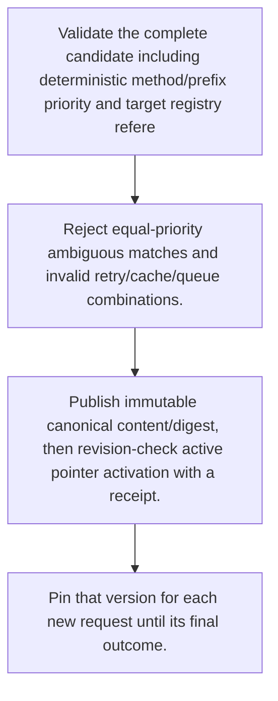

# Policy validation activation and route matching

The reference matcher uses longest matching prefix, then explicit numeric priority; unresolved ties are invalid. Rollback is a new audited activation. Bucket identity/migration must preserve remaining budget, not refill on every new policy version.

## Algorithm

1. Validate the complete candidate including deterministic method/prefix priority and target registry references.
2. Reject equal-priority ambiguous matches and invalid retry/cache/queue combinations.
3. Publish immutable canonical content/digest, then revision-check active pointer activation with a receipt.
4. Pin that version for each new request until its final outcome.

## Interfaces and storage boundary

Inputs include the target identity, caller/process identity, expected version/generation when applicable and operation key. The service returns a bounded committed result or stable error. [API fields](../contracts/api.md) and [data entities](../contracts/data-model.md) define the interface. No network send or computation waits inside the database writer.

The [transaction protocol](transactions.md) handles repeated receipts, contention, uncertain COMMIT and current-authority checks. New work rechecks mutable state after acquiring the writer. A stale client is not silently upgraded to a newer revision.

## Required behavior

## Policy and routing contract

| ID | Requirement |
| --- | --- |
| POL-01 | Define routes by validated method and path prefix, with deterministic priority and explicit ambiguity rejection. |
| POL-02 | Upstreams reference operator-registered loopback targets; client-controlled destination URLs are never accepted. |
| POL-03 | Publish an immutable policy version after complete validation; activation is atomic and revision checked. |
| POL-04 | Each new request pins one policy version through its whole lifecycle. Hot reload cannot mix old quota with new retry/cache rules. |
| POL-05 | Policies declare request/response limits, deadline, queue size/time, concurrency, quota, cache eligibility and retry rules. |
| POL-06 | Invalid policy changes leave the prior version active. Rollback activates a prior valid version as an audited new control action. |
| POL-07 | Lowering concurrency does not kill arbitrary active work or admit more work; existing occupancy drains until within the new limit. |

A control-store outage uses the last completely activated immutable policy for supported reads, but unavailable required quota/permit coordination fails closed for new protected forwarding. Do not silently switch global quotas to per-process quotas.

## Recovery and evidence

A failure before commit exposes no accepted transition; a lost response after commit is resolved with the same key. A second reconciler reloads current state and cannot duplicate a terminal transition. Test both serialization orders at the relevant race, using the [harness](../testing/harness-and-fixtures.md) and [source acceptance cases](../testing/acceptance-plan.md). These are planned tests, not observed results.
