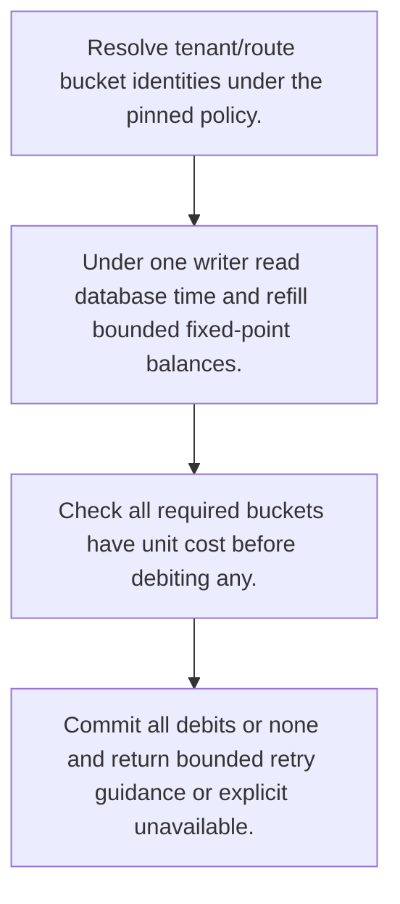

# Atomic hierarchical token buckets

Use integer microtokens and integer milliseconds with a documented rounding remainder. Backward wall-clock movement earns no refill; forward jumps are bounded by burst. A quota decision consumes one client request, including cache hits. GET retries use a separate upstream-attempt budget.

## Algorithm

1. Resolve tenant/route bucket identities under the pinned policy.
2. Under one writer read database time and refill bounded fixed-point balances.
3. Check all required buckets have unit cost before debiting any.
4. Commit all debits or none and return bounded retry guidance or explicit unavailable.

## Interfaces and storage boundary

Inputs include the target identity, caller/process identity, expected version/generation when applicable and operation key. The service returns a bounded committed result or stable error. [API fields](../contracts/api.md) and [data entities](../contracts/data-model.md) define the interface. No network send or computation waits inside the database writer.

The [transaction protocol](transactions.md) handles repeated receipts, contention, uncertain COMMIT and current-authority checks. New work rechecks mutable state after acquiring the writer. A stale client is not silently upgraded to a newer revision.

## Required behavior

## Rate limits and shared quotas

| ID | Requirement |
| --- | --- |
| LIM-01 | Implement a documented token-bucket contract per configured synthetic tenant/route key, with refill rate r and burst B. |
| LIM-02 | Multi-process requests cannot each receive a full independent copy of a shared bucket. The accounting update is atomic. |
| LIM-03 | If hierarchical buckets apply, acceptance consumes all required buckets together or none; no partial debit on rejection. |
| LIM-04 | Use bounded integer/fixed-point arithmetic and one authoritative clock per shared accounting operation. |
| LIM-05 | A denied request returns 429 and bounded retry-after guidance without forwarding upstream. |
| LIM-06 | Missing/unavailable mandatory quota state returns an explicit unavailable decision, not unlimited forwarding. |
| LIM-07 | Policy revision and bucket migration preserve a documented budget; resetting a policy must not refill every bucket accidentally. |

For a bucket initially full, accepted unit-cost requests over an interval must respect its declared r/B accounting semantics, verified with deterministic clock tests and concurrent operations. Backend client retries are separate upstream attempts and use a separate retry budget; they cannot create free unlimited upstream work.

The initial reference protocol may centralize atomic quota decisions. That is a known scaling limit. Any proposed production partitioning or preallocated budgets must specify key ownership, failure handling and a rigorous aggregate bound. Do not assume arbitrary distributed token leases preserve the same instantaneous rate bound.

## Recovery and evidence

A failure before commit exposes no accepted transition; a lost response after commit is resolved with the same key. A second reconciler reloads current state and cannot duplicate a terminal transition. Test both serialization orders at the relevant race, using the [harness](../testing/harness-and-fixtures.md) and [source acceptance cases](../testing/acceptance-plan.md). These are planned tests, not observed results.
