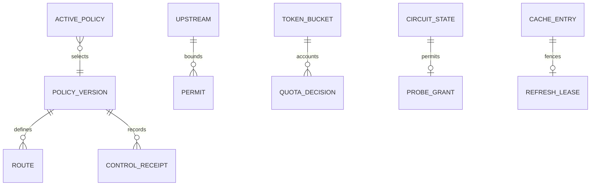

# Storage model and indexes

[Reference SQL](../../schemas/reference-schema.sql) defines the principal tables, keys, constraints and indexes. The complete [data dictionary](../contracts/data-model.md) explains the entities. Reference SQL is not a deployed migration.

Every connection enables foreign keys and documented journal/synchronous settings. Runtime databases live on supported local disk outside the synchronized checkout. Versioned migrations have checksums and exact compatibility gates; newer unknown schemas fail readiness.

Use composite identities where a child belongs to a release/room/version, unique receipt scopes and partial indexes for active authority. Index readiness/due-time scans and ordered history. Payloads are bounded; large repeated diagnostics are references/summaries rather than copies. Immutable content and terminal outcomes require restricted APIs plus migration triggers.

TokenBucket and Permit are canonical coordination. Policy history/receipts are durable; bounded data-plane metrics and per-process cache are rebuildable. Restart must preserve or conservatively expire authority, not refill budgets accidentally.

Read snapshots are short and coherent. Record/receipt retention must preserve required replay/deduplication identity through restore; no startup silently deletes data.
