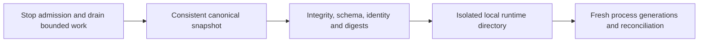

# Local operation backup and restore

The future launch scripts start ordinary loopback processes with tracked PIDs and locally served assets. Exact package versions and startup commands follow the permitted-environment inventory. This repository currently delivers design artifacts, not runnable product services.

Keep runtime stores outside OneDrive/network folders. Migrations are explicit, checksummed and preceded by a verified backup; unknown newer schemas fail readiness. Startup never resets data. A live database backup uses the supported consistent snapshot mechanism, including WAL-visible commits, not a main-file-only copy.

Preserve canonical identity, accepted outcomes, audit/control receipts, accounting and original deadlines together. Stop/quiesce relevant processes when a coordinated multi-store snapshot is necessary. Restore into a new isolated directory and preserve the original files. Fresh processes cannot revive expired grants by reusing friendly IDs.

Restore must preserve active complete policy, quota budget migration and conservative permit/circuit authority. A cold cache still obeys bounded miss collapse and origin capacity.

On unavailable storage stop new confirmations/grants, preserve evidence and revalidate readiness/authority after reconnect. Graceful shutdown drains bounded work; hard-stop behavior follows durable receipts and lease expiry. A snapshot cannot recover later commits absent from it.
