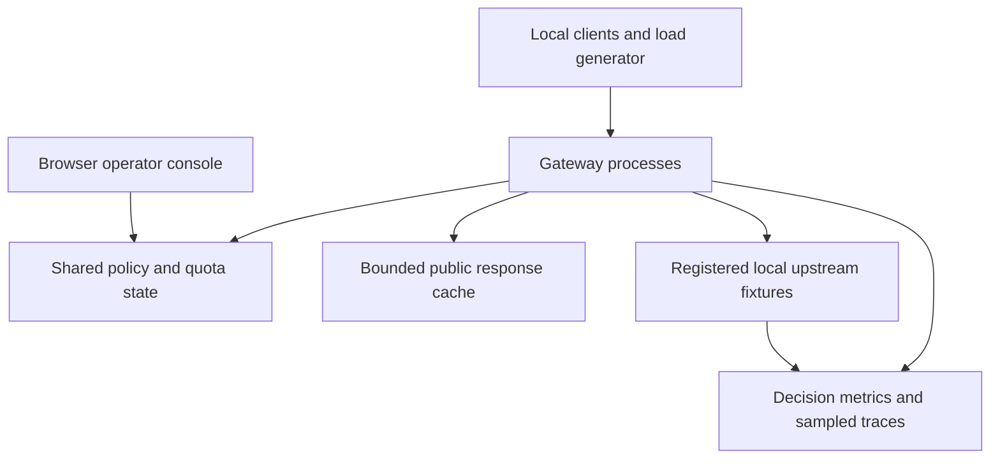

# Product requirements and scope

Keep useful API work moving when requests arrive faster than a backend can serve them. Explain each quota, overload, cache and timeout decision without hiding rejected traffic inside success metrics.

## Purpose and intended product

Build GateTrellis, an API gateway that keeps useful traffic flowing when demand exceeds backend capacity. It routes requests to registered local services, enforces quotas and concurrency, caches explicitly public responses, controls retries and returns clear overload decisions. A browser console shows offered load, admitted work, goodput, latency and the exact policy version behind each decision.

The architectural study targets 10 million incoming requests per minute across gateway replicas. Required implementation and acceptance run entirely on one desktop with at least 2 gateway processes and 3 controlled local upstream fixtures. Ten million requests/minute is an unverified scale hypothesis, not a claim that the desktop can sustain that rate.

The central challenge is correctness under pressure: a retry must not double an unsafe write, a stale configuration must not bypass a limit, and thousands of excess requests must not create an unbounded memory queue.

## Users and example workload

| User | Need |
| --- | --- |
| API owner | Protect a limited-capacity service and isolate one busy tenant/route from another. |
| Client developer | Receive predictable timeout, quota and retry guidance. |
| Operator | Activate reviewed policies and identify whether rejection is quota, overload, timeout or upstream failure. |
| Engineer | Measure a local capacity envelope without confusing rejected traffic with useful successful work. |

Synthetic services provide public catalogue reads, deliberately slow reads and a fake mutation endpoint with an observable local side-effect count. Fictional tenants are fixed fixture IDs, not real customers. No production endpoint or third-party host is a load target.

## Fit and evidence boundaries

Run the browser, gateways, coordinator/shared policy state, local store and upstream fixtures as ordinary local processes. All communication is loopback. Required features use no internet, Docker, GPU, sound, cloud service, Windows binary, real account or private data. Packages must exist in the supplied mirror before selection.

Language and framework are open. Use one supported shared coordination implementation with atomic operations; a local database or permitted local service is acceptable. A production Redis, Kubernetes cluster, external load balancer or cloud gateway is not required.

Evidence categories are mandatory: actual HTTP requests to local servers; unit-level deterministic quota traces; optional simulated larger traffic distributions; and analytical capacity projections. Never report simulated users, request records or a large count of 429 responses as proof of 10-million-request production capacity. The local gateway core must be useful and testable independently of future deployment.

## Scope

Required: versioned route policies, fixed upstream registry, route matching, tenant/route quotas, bounded queues and in-flight work, load balancing, health/circuit state, deadlines, safe retry rules, public-response caching, single-flight refresh, isolation, operator UI, load/fault harness and honest capacity report.

Deferred: full service mesh, internet proxying, production TLS termination, arbitrary plugins, WAF/exploit detection, attack tooling, global multi-region quota consensus, external OAuth, billing, streaming uploads, WebSockets, custom HTTP parser and AI inference infrastructure. Use the chosen runtime's supported HTTP implementation rather than inventing a partial insecure parser.

## Reference demonstration

Register 3 local upstream fixtures: a fast catalogue, a slow/error-injectable catalogue and a mutation counter. Run 2 gateway processes against common policy/quota state. Generate steady traffic, a hot-key burst, tenant imbalance, latency spikes and a stopped upstream.

The operator changes one route policy using expected revision and watches admission, retries, cache behaviour and successful upstream results. The fake mutation route demonstrates that a timed-out unsafe request is not automatically retried. The load report accounts for every offered request, including generator drops and client timeouts.

