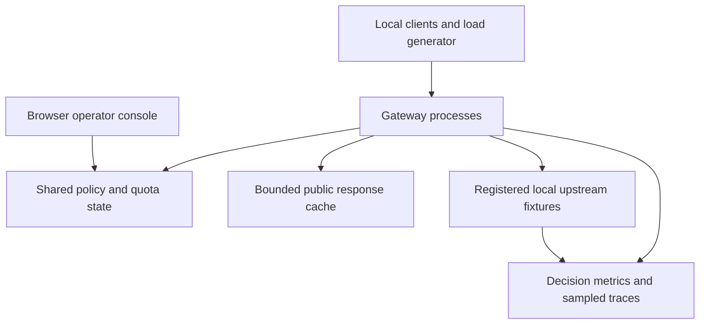

# GateTrellis Requirements

Version 0.3 | 23 November 2026 | Backend language agnostic | Basic browser UI required

**Project name:** GateTrellis  
**Product scope:** High traffic API gateway and overload protection  
**Suggested repository slug:** `gatetrellis`

## 1 Purpose and intended product

Build GateTrellis, an API gateway that keeps useful traffic flowing when demand exceeds backend capacity. It routes requests to registered local services, enforces quotas and concurrency, caches explicitly public responses, controls retries and returns clear overload decisions. A browser console shows offered load, admitted work, goodput, latency and the exact policy version behind each decision.

The architectural study targets 10 million incoming requests per minute across gateway replicas. Required implementation and acceptance run entirely on one desktop with at least 2 gateway processes and 3 controlled local upstream fixtures. Ten million requests/minute is an unverified scale hypothesis, not a claim that the desktop can sustain that rate.

The central challenge is correctness under pressure: a retry must not double an unsafe write, a stale configuration must not bypass a limit, and thousands of excess requests must not create an unbounded memory queue.

## 2 Users and example workload

| User | Need |
| --- | --- |
| API owner | Protect a limited-capacity service and isolate one busy tenant/route from another. |
| Client developer | Receive predictable timeout, quota and retry guidance. |
| Operator | Activate reviewed policies and identify whether rejection is quota, overload, timeout or upstream failure. |
| Engineer | Measure a local capacity envelope without confusing rejected traffic with useful successful work. |

Synthetic services provide public catalogue reads, deliberately slow reads and a fake mutation endpoint with an observable local side-effect count. Fictional tenants are fixed fixture IDs, not real customers. No production endpoint or third-party host is a load target.

## 3 Fit and evidence boundaries

Run the browser, gateways, coordinator/shared policy state, local store and upstream fixtures as ordinary local processes. All communication is loopback. Required features use no internet, Docker, GPU, sound, cloud service, Windows binary, real account or private data. Packages must exist in the supplied mirror before selection.

Language and framework are open. Use one supported shared coordination implementation with atomic operations; a local database or permitted local service is acceptable. A production Redis, Kubernetes cluster, external load balancer or cloud gateway is not required.

Evidence categories are mandatory: actual HTTP requests to local servers; unit-level deterministic quota traces; optional simulated larger traffic distributions; and analytical capacity projections. Never report simulated users, request records or a large count of 429 responses as proof of 10-million-request production capacity. The local gateway core must be useful and testable independently of future deployment.

Programme approval, project origin, code rights and participant-authored answers remain separate requirements. This reference specification does not certify eligibility or production readiness.

## 4 Scope

Required: versioned route policies, fixed upstream registry, route matching, tenant/route quotas, bounded queues and in-flight work, load balancing, health/circuit state, deadlines, safe retry rules, public-response caching, single-flight refresh, isolation, operator UI, load/fault harness and honest capacity report.

Deferred: full service mesh, internet proxying, production TLS termination, arbitrary plugins, WAF/exploit detection, attack tooling, global multi-region quota consensus, external OAuth, billing, streaming uploads, WebSockets, custom HTTP parser and AI inference infrastructure. Use the chosen runtime's supported HTTP implementation rather than inventing a partial insecure parser.

## 5 Reference demonstration

Register 3 local upstream fixtures: a fast catalogue, a slow/error-injectable catalogue and a mutation counter. Run 2 gateway processes against common policy/quota state. Generate steady traffic, a hot-key burst, tenant imbalance, latency spikes and a stopped upstream.

The operator changes one route policy using expected revision and watches admission, retries, cache behaviour and successful upstream results. The fake mutation route demonstrates that a timed-out unsafe request is not automatically retried. The load report accounts for every offered request, including generator drops and client timeouts.

## 6 Policy and routing contract

| ID | Requirement |
| --- | --- |
| POL-01 | Define routes by validated method and path prefix, with deterministic priority and explicit ambiguity rejection. |
| POL-02 | Upstreams reference operator-registered loopback targets; client-controlled destination URLs are never accepted. |
| POL-03 | Publish an immutable policy version after complete validation; activation is atomic and revision checked. |
| POL-04 | Each new request pins one policy version through its whole lifecycle. Hot reload cannot mix old quota with new retry/cache rules. |
| POL-05 | Policies declare request/response limits, deadline, queue size/time, concurrency, quota, cache eligibility and retry rules. |
| POL-06 | Invalid policy changes leave the prior version active. Rollback activates a prior valid version as an audited new control action. |
| POL-07 | Lowering concurrency does not kill arbitrary active work or admit more work; existing occupancy drains until within the new limit. |

A control-store outage uses the last completely activated immutable policy for supported reads, but unavailable required quota/permit coordination fails closed for new protected forwarding. Do not silently switch global quotas to per-process quotas.

## 7 Request lifecycle and outcome classification

Lifecycle is RECEIVED, VALIDATED, QUOTA_CHECKED, CACHE_CHECKED, WAITING_CAPACITY where permitted, FORWARDED, then COMPLETED, REJECTED, TIMED_OUT or CANCELLED. Retries are child attempts of one client request and preserve its original absolute deadline.

Every request has a gateway correlation ID, synthetic tenant, route/policy version and final category. Categories distinguish malformed input, quota rejection, overload rejection, circuit open, upstream timeout, upstream error, cache result, successful forwarding and client disconnect. A rejected request is not successful application goodput.

Validation bounds bytes before expensive parsing. No request is queued indefinitely or dispatched after its deadline. Admission and cache policies are explicit: synthetic tenant quotas count all requests, including cache hits; upstream concurrency applies only to forwarded attempts.

## 8 Rate limits and shared quotas

| ID | Requirement |
| --- | --- |
| LIM-01 | Implement a documented token-bucket contract per configured synthetic tenant/route key, with refill rate r and burst B. |
| LIM-02 | Multi-process requests cannot each receive a full independent copy of a shared bucket. The accounting update is atomic. |
| LIM-03 | If hierarchical buckets apply, acceptance consumes all required buckets together or none; no partial debit on rejection. |
| LIM-04 | Use bounded integer/fixed-point arithmetic and one authoritative clock per shared accounting operation. |
| LIM-05 | A denied request returns 429 and bounded retry-after guidance without forwarding upstream. |
| LIM-06 | Missing/unavailable mandatory quota state returns an explicit unavailable decision, not unlimited forwarding. |
| LIM-07 | Policy revision and bucket migration preserve a documented budget; resetting a policy must not refill every bucket accidentally. |

For a bucket initially full, accepted unit-cost requests over an interval must respect its declared r/B accounting semantics, verified with deterministic clock tests and concurrent operations. Backend client retries are separate upstream attempts and use a separate retry budget; they cannot create free unlimited upstream work.

The initial reference protocol may centralize atomic quota decisions. That is a known scaling limit. Any proposed production partitioning or preallocated budgets must specify key ownership, failure handling and a rigorous aggregate bound. Do not assume arbitrary distributed token leases preserve the same instantaneous rate bound.

## 9 Capacity bulkheads and queueing

Global, route and upstream concurrency are finite. Acquire required permits atomically or with a tested no-leak protocol before forwarding. Limits protect gateway-authorized attempts; they do not magically stop arbitrary downstream work that survives a lost connection.

Pending queues are bounded by count and bytes, with a maximum waiting duration, initially 50 ms. A request waits only if useful service can plausibly finish within its remaining deadline. Otherwise reject early with 503 overload and documented retry guidance. Health/administration has separate small capacity so diagnostics survive overload.

An active attempt holds its permit until upstream transport has closed or a documented conservative lease/deadline rule makes orphan authority safe. Cancellation requests alone are not proof the upstream stopped. Cooperative local fixtures observe cancellation and deadlines; noncooperative-origin limits must be reported separately. Crash recovery never releases the same permit twice or silently multiplies capacity across gateway replicas.

Isolate synthetic tenants with explicit bounded shares or fair queue scheduling. State the fairness rule and measure starvation; strict global request FIFO is not required. Protect a small low-volume route from a burst on another route using separate bulkheads.

## 10 Load balancing and upstream health

Select among compatible registered upstreams by a deterministic documented policy, such as least authorized in-flight with a stable tie-breaker. Respect per-upstream capacity, readiness and draining status. A draining target receives no new requests but may finish existing work.

Passive errors and bounded active health checks influence routing. Circuit states are CLOSED, OPEN and HALF_OPEN. Opening/closing thresholds, observation windows and cooldowns are explicit. Across gateway processes, half-open probe permission is coordinated so a recovering service is not flooded by one probe per waiting request.

At least one path must demonstrate recovery from a stopped/unhealthy fixture. A single hot route cannot shift unlimited traffic to another upstream just because its first target failed. Health checks have their own small retry/concurrency budget.

## 11 Deadlines cancellation and retries

Every request has a finite gateway absolute deadline; default local profile is 1 second. Connect, queue, each attempt and retry delay all consume this budget. Do not reset the deadline on failover. Propagate remaining budget to cooperative fixtures and stop forwarding when no useful time remains.

Only explicitly safe GET/HEAD routes may automatically retry in the first release, at most one additional attempt and only before response bytes have been committed to the client. Mutation requests are not retried merely because an idempotency header exists. Extending retry support requires a verified origin idempotency contract and new tests.

Retryable connection failures/status codes are allowlisted. Apply bounded jitter and a shared retry budget, initially no more than 10 extra attempts per 100 primary upstream attempts over a documented window. Circuit-open, quota rejection and exhausted deadlines do not trigger immediate loops. A retry consumes concurrency and is counted in amplification metrics.

A client disconnect triggers cancellation/cleanup; the request outcome records uncertainty if the origin might have committed a side effect. Never fabricate a success or assert a downstream rollback from a connection close.

## 12 Public caching and stampede control

Cache only explicitly eligible public GET responses from local fixture routes. Bypass requests with authorization/cookies or personalized context, and bypass responses marked private/no-store or containing session-setting headers. Include route/policy generation, normalized path/query and supported Vary dimensions in the cache key. Unknown Vary values bypass caching.

Respect configured origin freshness and validators for the supported subset; document that this is a constrained gateway cache, not full HTTP cache compliance. Initially cache only 200 responses below 64 KiB, with bounded total bytes and deterministic eviction. Do not cache errors, mutations or response bodies exceeding the cap.

Collapse concurrent misses for the same key into one refresh per gateway cache owner; bound waiters and their deadlines. If caches are per process, document up to one refresh per process rather than falsely claiming one cluster-wide fetch. The reference shared-key lease protocol may reduce this to one global refresh if implemented and tested. Expired refresh authority cannot overwrite a newer cache generation.

Serving stale public data is allowed only by an explicit route rule with a finite stale window and a visible response/metric indicator. It must not bypass privacy checks or claim fresh success. Cache invalidation includes policy version and fixture content revision so a control change cannot expose old incompatible data.

## 13 Logical state and persistence

| Entity | Required content |
| --- | --- |
| RoutePolicyVersion | Immutable validated document/digest and publication metadata. |
| ActivePolicy | Revision-checked active version reference. |
| UpstreamRegistry | Loopback target ID, capabilities, capacity and drain state. |
| TokenBucket | Scoped key, units/refill timestamp and policy migration state. |
| ConcurrencyPermit | Request/attempt identity, scope, owner, lease/deadline and released outcome. |
| CircuitState | Scope, observations, phase/cooldown and probe authority. |
| CacheEntry/RefreshLease | Key/version, bounded response metadata/body, freshness and fenced refresh ownership. |
| ControlReceipt | Unique actor/operation/target/key and immutable accepted result. |
| MetricsWindow | Aggregated counters/histograms, labelled actual load and sampled request traces. |
| AuditEvent | Ordered operator/policy transitions and important failure decisions. |

The gateway need not persist every successful data-plane request forever; bounded metrics and sampled traces avoid making logging the bottleneck. Control receipts and policy history remain durable. Quota/concurrency recovery must document which state is durable and how restart avoids granting extra authority. Explicit nonnull IDs, unique scoped keys and bounded values are required.

## 14 API and local fixture contracts

| Endpoint | Behaviour |
| --- | --- |
| GET /api/health, /api/ready | Liveness separate from policy/store/fixture readiness. |
| POST /api/policies/drafts, /validate, /publish | Edit and publish complete immutable policy. |
| POST /api/policies/{id}/activate | Revision-checked keyed activation/rollback. |
| POST /api/upstreams | Register permitted loopback fixture. |
| POST /api/upstreams/{id}/drain | Stop new forwarding to target. |
| GET or POST /proxy/{route}/... | Actual local data-plane request with bounded contract. |
| GET /api/decisions, /api/metrics | Filtered sampled traces and aggregate outcomes. |
| GET /api/circuits, /api/quotas, /api/capacity | Current enforcement and age/authority details. |
| POST /test/scenarios | Explicit test-mode-only fixture latency/error control. |

Policy example: `{"route":"catalogue","methods":["GET"],"deadlineMs":1000,"maxInFlight":20,"maxQueue":40,"queueWaitMs":50,"retryMaxAdditionalAttempts":1,"cachePublic":true}`. Full schema also defines upstreams, bucket scopes and bounds.

Return 400/422 for malformed/invalid control content, 403 for denied demo role, 404 for unmatched route, 409 for stale control revision/key conflict, 413 for size rejection, 429 for quota denial, 502 for defined upstream failure, 503 for overload/unavailable coordination and 504 for deadline expiry where no response has started. Do not rewrite all failures into 200 responses. Explain unsupported streaming/partial-response cases explicitly.

## 15 Browser operator application

Screens include route/policy editor with validation and activation diff; gateway/upstream health; offered/admitted/completed request charts; quota/circuit/capacity views; cache hit/miss/refresh view; sampled decision timeline; and controlled local scenario runner.

Show request rate and useful goodput separately. Show all latency outcomes and rejections; a low p95 achieved by rejecting almost every request is not a success. Distinguish simulated arrivals from real completed HTTP requests. Include policy version on traces, permission errors, stale edit conflicts, loading/disconnected states and keyboard-accessible tables.

The scenario UI operates only allowlisted fixture processes. It cannot enter arbitrary public URLs or initiate unbounded traffic. Test mode is visibly enabled and disabled by default.

### Basic HTML and JavaScript or TypeScript UI

A basic working UI is a mandatory release deliverable. Use semantic HTML, ordinary CSS and plain JavaScript, or TypeScript compiled to browser JavaScript. The backend language remains open. Native HTTP requests, simple tables, numeric summaries and optional small SVG charts cover the required console.

| Minimum view | Visible information and working controls |
| --- | --- |
| Routes and policies | Route table, policy JSON/form editor, validation errors, version/diff view and confirmed activation/rollback action. |
| Traffic dashboard | Offered/sent/admitted/completed rates, useful goodput, response categories, latency, cache status and policy version. |
| Upstreams and diagnostics | Target readiness/circuit/capacity table, drain control, quota reasons and bounded sampled request detail. |
| Local scenario panel | Allowlisted fixture selector, bounded test profile, start/stop and clear test-mode status. |

| ID | Basic UI requirement |
| --- | --- |
| GW-UI-01 | Serve all pages, CSS, scripts and optional assets locally from the application origin; core console operation requires no internet. |
| GW-UI-02 | JavaScript is the dependency-minimal path. Optional TypeScript must compile with a compiler available through the permitted mirror, using a documented local command. Serve generated JavaScript; no runtime compilation or remote package fetch is required. |
| GW-UI-03 | A small HTML/CSS/JavaScript module layout is sufficient. A frontend framework/build system is optional and must pass the dependency gate if selected. |
| GW-UI-04 | Policy validation, activation and target controls call actual APIs, preserve expected revisions and show confirmed server outcomes or conflicts. |
| GW-UI-05 | Poll bounded aggregate metrics at a documented interval; limit sampled rows and pause unnecessary background refresh. The browser dashboard is not the high-rate load generator. |
| GW-UI-06 | Provide labels, keyboard controls, text status and request errors. Enforce roles, target allowlists and load caps on the backend regardless of browser controls. |

Frontend acceptance is functional: a reviewer can inspect a route, validate and activate a policy, send a sample local request, run a bounded fixture scenario and see the resulting quota/overload/cache decisions. Display measured and modeled rates in separately labelled fields so the simple dashboard cannot imply a production benchmark.

## 16 Failure handling and operations

Gateway restart must load the last active complete policy, recover or conservatively expire old permits and preserve control receipts. Coordination outage has an explicit route-level safe behaviour; no accidental quota bypass. Cache may be cold after restart, but cache-miss recovery stays bounded.

Stop fixture/gateway processes through tracked task-owned PIDs only. Graceful drain stops admission and finishes bounded in-flight work. Hard-kill tests preserve commit uncertainty. Explicit schema migrations refuse incompatible state and never reset the store silently. Consistent backup/restore includes policy versions, active pointer, receipts and coordination state needed for conservative recovery; old owner epochs cannot become fresh after restore.

Local security is ordinary application access control: loopback binding, Host/Origin checks, fictional roles, disposable demo tokens if necessary, bounded payloads and escaped UI text. No real credentials, external traffic, offensive security work or live customer data is involved.

## 17 Measured desktop acceptance targets

Begin with a 100-real-request/second calibration. Provisional target is 1,000 offered small HTTP requests/second through 2 gateway processes against trivial local fixture reads, for 60 seconds, within available resources. Cache-hit and uncached profiles are measured separately; target is not automatically required of a deliberately slow backend.

Record p50/p95/p99 total latency, goodput, error categories, queue occupancy, permit occupancy, retry amplification, cache rate, bytes, generator start delay and CPU/RAM for every component. Provisional gateway-added p95 overhead on an unloaded fast fixture is <=20 ms; local UI update <=3 seconds; total service/store steady-state memory <=2 GiB excluding browser/generator/build. Calibrate upstream capacity before overload tests.

At two to five times calibrated useful backend capacity, queues remain bounded, the low-volume protected route retains its configured share, and admitted useful work does not collapse into timeouts solely because the gateway accepted unbounded demand. Report the measured comparison, not a promised universal latency bound.

## 18 Load methodology and scale arithmetic

Use open-loop arrivals for overload and record scheduled versus actual start time to expose generator lag. A closed-loop client test may be supplementary but must not hide reduced offered traffic when latency rises. Reconcile offered count with generator-not-sent, actual sent and every final response/timeout/disconnect. Measure socket/pool reuse explicitly.

A long run may issue 1 million sequential/multiplexed local requests, but that count is not 1 million simultaneous users. Keep a resource/time cap and report incomplete runs honestly. Tests target only the local fixtures, use no system-wide network changes and stop before exhausting the desktop.

The architectural target 10,000,000 requests/minute equals about 166,667 requests/second. At 2 KiB response payload each, application response traffic alone is about 341.3 MB/second or 2.73 Gbit/second, excluding request traffic, HTTP/TLS overhead and retransmission. At a modeled 90 percent eligible cache-hit rate, average origin demand would be about 16,667 requests/second before refreshes/retries; cache eligibility, skew and misses make this an assumption, not evidence.

Capacity study must model hot keys, shared quota serialization, cache ownership, connection pools, failure reserve and egress separately. Derive node counts from measured sustainable CPU/network/connection limits with explicit utilization headroom. Identify operations that still serialize globally. Explain which higher-scale redesigns are unimplemented. Neither a central database transaction per request nor added gateway replicas is automatically a production-scale solution.

## 19 Acceptance catalog

| ID | Scenario and required oracle |
| --- | --- |
| GW-AC-01 | Validate route/policy and reject ambiguous or invalid configuration without replacing the active version. |
| GW-AC-02 | Concurrent policy activation pins each request to one complete version. |
| GW-AC-03 | Two gateway processes enforce shared token bounds under deterministic and concurrent traces. |
| GW-AC-04 | Hierarchical limit failure consumes no partial quota and forwards nothing. |
| GW-AC-05 | Quota-state outage fails closed on protected forwarding with a clear unavailable outcome. |
| GW-AC-06 | Global/route/upstream permits and pending queues remain within declared bounds. |
| GW-AC-07 | A noisy tenant does not starve the configured protected low-volume share. |
| GW-AC-08 | Queue and retry time count against the original deadline; no expired request is forwarded. |
| GW-AC-09 | Safe GET retry obeys allowlist, deadline, maximum attempts and amplification budget. |
| GW-AC-10 | Fake mutation times out after origin side effect; gateway does not automatically retry it. |
| GW-AC-11 | Unhealthy target opens circuit and coordinated half-open probes remain bounded. |
| GW-AC-12 | Target recovery/drain changes routing without unlimited failover traffic. |
| GW-AC-13 | Public cache respects key/version and explicit freshness; private/cookie/authorization data bypasses sharing. |
| GW-AC-14 | Hot-key miss collapse stays within documented per-process or global refresh scope and waiter bounds. |
| GW-AC-15 | Stale refresh cannot overwrite newer content/policy generation. |
| GW-AC-16 | Client disconnect and gateway kill do not leak or double-release permits; orphan-work limits are reported honestly. |
| GW-AC-17 | Cache/coordination restart produces bounded cold-start behaviour, not an unbounded origin stampede. |
| GW-AC-18 | Actual open-loop profile reconciles every offered request and identifies generator saturation. |
| GW-AC-19 | Overload profile reports goodput, all outcomes and queue bounds rather than only successful-response p95. |
| GW-AC-20 | Operator browser activation/inspection/stale tabs, keyboard and error states work. |
| GW-AC-21 | Nonlocal target, oversized bodies, unexpected origin and unauthorized control are rejected. |
| GW-AC-22 | Consistent restore recovers complete policy/receipts and cannot revive stale permit authority. |
| GW-AC-23 | Thirty-minute bounded soak and offline end-to-end operation pass with measured resources. |
| GW-AC-24 | Scale report clearly separates actual HTTP throughput, million-request totals and 10-million/minute hypotheses. |
| GW-AC-25 | Basic HTML/CSS/JS or compiled-TS console loads with only local assets and performs policy validation/activation, sample requests, diagnostics and bounded scenario controls against real APIs, including stale/error and keyboard flows; optional TypeScript compilation works through the permitted local toolchain. |

All outcomes start NOT RUN. Preserve commit/environment, workload schedule, fixture modes, request accounting, histograms, resource samples, receipts and invariant evidence. Repeat policy/quota/permit contention 100 rounds and critical crash/uncertain-response windows 20 times. Never regenerate an evidence report over recorded results.

## 20 Milestones and delivery

| Milestone | Exit condition |
| --- | --- |
| 1 | Verify tools; real local HTTP fixtures, browser/readiness and control schemas work. |
| 2 | Route matching, immutable policy and actual forwarding pass contracts. |
| 3 | Multi-process quotas, permits and bounded queues pass atomicity tests. |
| 4 | Deadlines, cancellation and safe retry budget pass failure scenarios. |
| 5 | Health balancing, circuit probes and drain recover correctly. |
| 6 | Public caching, key isolation and refresh-collapse tests pass. |
| 7 | Operator UI and actual open-loop local load generator are complete. |
| 8 | Run overload/soak/crash/offline/restore suites and produce a defensible capacity report. |

Milestones may span multiple sessions. Deliver source/licence notices, local scripts, route/policy schemas, protocol contracts, fixture upstreams, browser UI, test/load harness, actual acceptance evidence, measurements, capacity calculations and continuation notes. Completion requires no unresolved defect violating admission, privacy, retry or bounded-resource contracts; a modeled global rate alone is insufficient.

## 21 Open choices and primary references

Choose language/framework, one shared coordination store, cache ownership, precise fairness policy, metric storage and package versions after environment inventory. Full production deployment is not required to finish the local scope.

- AWS overload and early rejection principles: https://aws.amazon.com/builders-library/using-load-shedding-to-avoid-overload/
- AWS timeouts/retries/backoff/jitter: https://aws.amazon.com/builders-library/timeouts-retries-and-backoff-with-jitter/
- HTTP caching and private/shared boundaries: https://developer.mozilla.org/en-US/docs/Web/HTTP/Guides/Caching

Sources inform concepts; the specified local gateway and targets are original proposed requirements, not capabilities inherited from those references.
