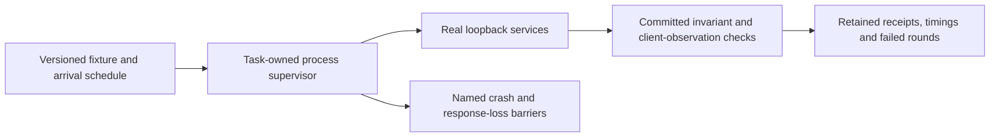

# Fault harness and fixture contracts

Use fast catalogue, slow/error catalogue and mutation-counter fixtures. The unsafe-mutation timeout test records one observable local effect and zero gateway-created automatic retry. Quota traces use deterministic clock/oracle schedules.

Each case owns isolated stores, ports, generated roles, seed and process IDs. Barriers acknowledge the exact commit/grant/send position before the harness kills or releases a tracked process. A stop before commit and a lost response after commit are separate scenarios. Fault controls exist only in explicit test mode.

Run critical crash windows at least 20 times and shared authority/contention races at least 100 rounds. Keep every failed seed. Assert quantity/capacity/order bounds during transitions as well as after final settlement. A thirty-minute bounded soak records process/generator memory, backlog and missing progress.

Local workload: Two gateway processes, three local upstream fixtures; calibrate at 100 real requests/s and target 1,000 offered small requests/s for 60 seconds. Cache-hit and uncached profiles are separate.

Use open-loop schedules and retain scheduled versus actual start time. Preserve not-sent requests and generator saturation, transport timeouts/disconnects and unfinished work. Stop before resource exhaustion; no system-wide tuning or external targets are required. Canonical fixture digests come from an independent oracle during implementation; none are invented here.

Evidence contains commit, tool/store versions, OS/CPU/RAM, policy/config, fixture seed, actual clients/sockets, request keys, barriers, receipts, server/client observations and invariant verdict. The [acceptance catalog](acceptance-plan.md) includes every required scenario.
